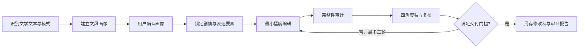

# 文学文风自适应 Humanizer 套件

一个仅用于文学创作的“去 AI 味”与文风保护工作流。它适用于小说、散文、叙事文学和文学化非虚构：在不改动剧情、人物、情感曲线、叙述视角、核心意象或结局的前提下，对有证据的模板化表达进行最小幅度编辑，并通过完整性审计和独立复核控制风险。

> 它不是通用文案润色工具，也不用于营销、职场、科普、学术或一般知识文本。风险分是启发式文本风险，不是 AI 参与比例、作者身份判断或检测结论。

## 套件能力

| 模块 | 作用 |
| --- | --- |
| `humanizer` | 主入口：选择模式、控制确认门、调度全流程、管理迭代和交付 |
| `humanizer-style-profiler` | 从作者代表作或目标稿建立有证据的文风画像 |
| `humanizer-literary-editor` | 依据画像进行最小幅度文学编辑，保护叙事内容 |
| `humanizer-integrity-auditor` | 锁定内容要素，执行确定性与语义完整性审计，防止实质改写 |
| `humanizer-ai-reviewer` | 组织文风、语言、叙事完整性和普通读者四个独立角度的复核 |

## 能解决什么问题

- 保留作者已有声音的前提下，减少解释性回声、虚假转折、机械节奏、伪精确、公式化升华和过度工整。
- 避免“为了自然”而误删人物对白、有效重复、关键数字、物件、意象、伏笔与留白。
- 把作者稳定特征、可调整项和看似模板但应保留的文学选择区分开。
- 在修改前锁定剧情、关系、视角、时态、时间线、关键对白、情绪曲线、结局和用户指定原句。
- 对修改后的稿件进行可解释的独立审阅；仅返修被明确指出的片段，最多三轮。

## 使用模式

### 恒稳模式：长期作者文风

适用于希望持续按同一作者文风编辑的场景。

- 提供至少 3 篇经作者确认、文风相近的代表作。
- 先生成文风画像，展示保护项、风险项和修改方向。
- 用户明确确认后，画像保存到当前项目的 `.humanizer/profiles/`，供后续稿件复用。
- 样本不足 3 篇时，不保存长期画像；改用单篇模式或补充样本。

### 单篇模式：只处理当前稿件

适用于只希望修改一篇文学稿，或没有足够代表作的场景。

- 仅从当前目标稿建立临时、低置信度画像。
- 用户确认画像和编辑方向后才改稿。
- 临时画像不会保存到磁盘。

## 标准工作流



不可跳过的顺序：

1. 判断文本是否属于文学创作，并选择恒稳或单篇模式。
2. 生成并展示文风画像、保护项和修改方向；等待用户确认。
3. 建立内容锁定清单，明确不能改变的叙事与表达要素。
4. 只根据有证据的信号进行局部编辑，不增写背景、动机、情节、对白或象征解释。
5. 运行确定性检查与语义完整性审计；任何实质内容变化都阻止交付。
6. 进行四个相互独立的审阅：文风一致性、AI 语言痕迹、叙事/情感完整性和普通读者体验。
7. 风险未达门槛时，只返修审稿证据指向的片段，最多三轮；继续修改会伤害内容时停止并如实说明。
8. 始终另存新稿和审计报告，绝不覆盖原稿。

## 快速开始

将本套件安装在 Codex Skills 根目录，使五个子目录位于同一层级：

```text
$CODEX_HOME/skills/
├─ humanizer/
├─ humanizer-style-profiler/
├─ humanizer-literary-editor/
├─ humanizer-integrity-auditor/
└─ humanizer-ai-reviewer/
```

然后用自然语言提供文学稿和期望：

```text
请用单篇模式处理这篇短篇小说：先展示文风画像和修改方向，等我确认后再做最小幅度去 AI 味编辑。不得改变人物关系、叙述视角、结局和关键对白。
```

恒稳模式示例：

```text
我会提供三篇确认由我创作的代表作和一篇目标稿。请建立可复用的作者文风画像，先让我确认画像，再按该画像处理目标稿。
```

## 文件支持与交付

支持直接粘贴文本、`.txt`、`.md` 和 `.docx`。

- 文本：在对话中返回完整改稿与审计报告。
- TXT/MD：保持编码、标题层级和段落结构，另存为 `<原名>-去AI味.<扩展名>`。
- DOCX：先检测批注、修订、脚注、尾注和文本框；保留段落顺序、标题、表格文字和主要样式，并在交付前渲染核验。
- 审计报告：输出为 `<原名>-去AI味-审计报告.md`；如果文件名冲突，使用递增版本后缀。

## 审计与交付门槛

最终交付需要同时满足：

- 确定性完整性检查通过。
- 语义完整性审计没有实质问题。
- 四个独立审阅已完成，叙事完整性角色无实质问题。
- 汇总的启发式 AI 痕迹风险不高于 20。

如果继续降低风险会损伤剧情、人物、情感、意象或结尾，则应停止在最安全版本，并明确标记“未达到 20 分门槛”。

## 内置脚本

```powershell
# 生成文风统计（仅辅助画像，不能替代文本证据）
python humanizer-style-profiler/scripts/style_metrics.py manuscript.md --pretty

# 比较原稿、改稿与锁定清单的硬约束
python humanizer-integrity-auditor/scripts/integrity_check.py `
  --original original.md --revised revised.md --lock content-lock.json --pretty

# 汇总四个独立复核结果，计算交付门槛
python humanizer-ai-reviewer/scripts/aggregate_reviews.py `
  --reviews style.json language.json narrative.json reader.json `
  --integrity integrity.json --semantic-pass --pretty

# 检查、提取或应用 DOCX 文本映射
python humanizer-integrity-auditor/scripts/docx_text_map.py --help
```

## 目录结构

```text
suite.json                        套件清单与入口说明
humanizer/                        主编排 Skill
humanizer-style-profiler/         文风画像与统计脚本
humanizer-literary-editor/        最小幅度文学编辑规则
humanizer-integrity-auditor/      内容锁定、完整性审计和 DOCX 映射
humanizer-ai-reviewer/            四角度复核与风险汇总
```

## 安全与边界

- 不把文字风格推断为作者身份，也不把风险分解释为 AI 来源鉴定。
- 不覆盖源文件，不静默删除 DOCX 修订、批注、脚注、尾注或文本框。
- 不基于单个词、短句、比喻、重复或数字机械判定 AI 痕迹；先判断其叙事功能与作者画像。
- 不在缺少用户确认的画像或内容锁定清单时进行正式改稿。

## 许可

当前项目未附带开源许可证。若计划公开分发或接受外部贡献，请先补充适用许可证。
